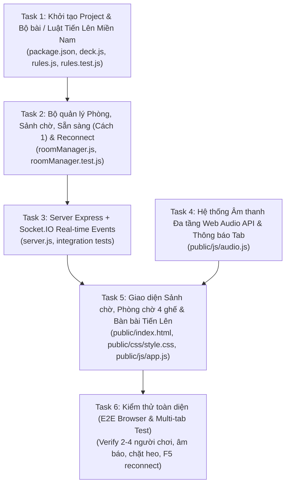

# Implementation Plan: Tiến Lên Miền Nam Online Nội Bộ (2–4 Người Chơi)

## 1. Overview (Tổng quan)
Xây dựng hệ thống Web Game **Tiến Lên Miền Nam Online Nội Bộ** thời gian thực (2–4 người chơi), bao gồm:
- **Sảnh chờ nội bộ (Live Lobby)** cập nhật danh sách bàn theo thời gian thực + Vào bàn bằng **Mã phòng 4 số** hoặc **Link mời trực tiếp (`?room=XXXX`)**.
- **Cơ chế Sẵn sàng & Chia bài (Cách 1):**
  - Bàn 2–3 người: Khi 100% người chơi trong bàn bấm **Sẵn sàng ✅**, Chủ phòng (Host) mở khóa nút **"🃏 Bắt đầu chia bài"**.
  - Bàn đủ 4/4 người: Ngay khi người thứ 4 vào bàn -> **Nổ Âm báo Tập hợp + Desktop Notification + Nháy Tab**. Khi cả 4/4 bấm **Sẵn sàng ✅** -> Hệ thống **tự động đếm ngược 3... 2... 1** (kèm tiếng bíp) và chia bài.
- **Game Engine Tiến Lên Miền Nam:** Xử lý trên Server (chống gian lận, ẩn bài đối thủ), hỗ trợ đầy đủ các bộ bài, chặt Heo/Hàng, kết nối lại (Reconnect) khi F5, và chế độ Khán giả (Spectator) cho người vào sau.

---

## 2. Dependency Graph (Sơ đồ phụ thuộc triển khai)

---

## 3. Architecture Decisions (Quyết định Kiến trúc)
1. **Server-Authoritative State (Server nắm quyền quyết định):**
   - Toàn bộ bài trên tay 4 người chơi chỉ lưu ở RAM của Server (`roomManager.js`).
   - Khi gửi trạng thái bàn (`room:state`) xuống từng người chơi, Server chỉ gửi mảng lá bài thật (`myHand`) cho đúng chủ nhân của ghế đó; các ghế đối thủ chỉ nhận số lượng lá còn lại (`cardCount`), tránh việc mở F12 xem trộm bài.
2. **Định danh bằng `playerToken` lưu trong `localStorage`:**
   - Khi kết nối Socket.IO, client gửi kèm `{ playerToken, nickname }`. Nếu `socket.id` thay đổi do F5 hoặc rớt mạng tạm thời, `roomManager` ánh xạ lại `playerToken` vào đúng ghế cũ và trả lại bài đang cầm.
3. **Web Audio API Synthesizer (Không dùng file MP3 rời):**
   - Dùng bộ dao động âm thanh (`OscillatorNode` + `GainNode`) của trình duyệt để tạo tiếng *Ting-tong* (người thứ 2-3 vào), *Fanfare Chuông Tập Hợp* (đủ 4/4 người), *Còi Gõ Bàn* (nhắc đồng đội AFK), *Tiếng Bíp đếm ngược* và *Tiếng đánh bài / chặt Heo*.
   - Kích hoạt `audioCtx.resume()` ngay tại sự kiện click nút *"Tạo bàn"* hoặc *"Vào bàn"* để không bị Chrome/Safari chặn Autoplay khi ẩn tab.
4. **Cơ chế Đếm ngược An toàn (Cancelable Countdown):**
   - Khi kích hoạt đếm ngược 3 giây trước khi chia bài, nếu có bất kỳ ai bấm *"Hủy sẵn sàng"* hoặc thoát phòng trong lúc đang đếm ngược, Server hủy timer ngay lập tức và thông báo về bàn.

---

## 4. Task List Summary (ộ trình thực hiện theo lát cắt dọc)

Detailed tasks are tracked in [todo.md](file:///d:/DU_AN/Game%20Tien%20Len/tasks/todo.md).

### Phase 1: Core Engine & Room Logic (Nền tảng Luật bài & Phòng chờ)
- [x] **Task 1:** Khởi tạo dự án, Bộ bài 52 lá (`deck.js`) và Luật Tiến Lên Miền Nam (`rules.js`) kèm Unit Tests.
- [x] **Task 2:** Xây dựng Quản lý Sảnh chờ & Phòng chơi (`roomManager.js`) theo **Cách 1** (Sẵn sàng, Báo đủ 4 người, Chia bài, Reconnect) kèm Unit Tests.
- [x] **Checkpoint 1:** Chạy `npm test` vượt qua 100% bài test logic luật chơi và luồng phòng chờ.

### Phase 2: Real-time Server & Audio Engine (Kết nối Thời gian thực & Âm báo)
- [x] **Task 3:** Xây dựng Server Express + Socket.IO (`src/server.js`) điều phối sự kiện Sảnh chờ, Phòng, Đếm ngược, Gõ bàn, Đánh bài và hiển thị IP LAN.
- [x] **Task 4:** Xây dựng Module Âm thanh Đa tầng & Thông báo ngoài Tab (`public/js/audio.js`).
- [x] **Checkpoint 2:** Kiểm thử kết nối Socket.IO giữa nhiều client giả lập và kiểm tra các hàm phát âm thanh/thông báo.

### Phase 3: Frontend UI & End-to-End Verification (Giao diện Bàn chơi & Kiểm thử Thực tế)
- [x] **Task 5:** Xây dựng Giao diện Sảnh chờ, Phòng chờ 4 ghế, Link mời `?room=XXXX` và Bàn đánh bài Tiến Lên (`index.html`, `style.css`, `app.js`).
- [x] **Task 6:** Kiểm thử thực tế đa cửa sổ trình duyệt (2–4 người chơi, âm báo đủ 4 người, chặt Heo, F5 giữ ghế) và nghiệm thu.
- [x] **Checkpoint 3:** Hoàn tất toàn bộ tiêu chí trong [SPEC.md](file:///d:/DU_AN/Game%20Tien%20Len/SPEC.md), sẵn sàng bàn giao.

---

## 5. Risks and Mitigations (Rủi ro & Giải pháp)
| Rủi ro | Mức độ | Giải pháp khắc phục |
|--------|--------|---------------------|
| Trình duyệt chặn âm báo khi người chơi đang mở tab khác | Cao | Gọi `unlockAudio()` ngay khi người chơi click nút "Tạo bàn" / "Vào bàn", kết hợp thêm `Desktop Notification` và hiệu ứng nhấp nháy tiêu đề Tab. |
| Đang đếm ngược 3..2..1 để chia bài thì có người thoát phòng hoặc hủy Sẵn sàng | Trung bình | Server kiểm tra và hủy `countdownTimer` ngay lập tức khi có sự kiện `leave` hoặc `unready`. |
| Người chơi lỡ bấm F5 giữa ván bài làm mất kết nối Socket cũ | Cao | Dùng `playerToken` trong `localStorage` để map lại ghế cũ ngay khi Socket mới kết nối lại (Grace period 120 giây). |
| Ván đầu tiên chơi 2 hoặc 3 người nên không ai cầm lá `3♠` | Trung bình | Luật xử lý tự động: Ván đầu tiên ai giữ **lá bài nhỏ nhất trong số những lá đã chia trên bàn** (VD: `3♣` hoặc `4♠` nếu không có `3♠`) sẽ được quyền đi trước và phải đánh bộ chứa lá nhỏ nhất đó. |

---

## 6. Open Questions
- Không còn câu hỏi mở. Đang chờ lệnh **"ok code đi"** từ người dùng để bắt đầu Task 1.
